<picture>
  <source media="(prefers-color-scheme: dark)" srcset="./assets/banner-dark.svg">
  
</picture>

### I keep production boring.

SRE / DevOps engineer with 10+ years in IT and 5+ in cloud. I run high-criticality infrastructure where downtime is not an option. I build observability that pages for the right reasons, automate the toil away, and write the post-mortem so it never happens twice.

🇧🇷 [Leia em português](./README.pt-BR.md)

## 📈 Impact

| | |
|---|---|
| **5,000 servers** migrated from CentOS to Oracle Linux | Ansible playbooks cut the team from 10 people to 2 and the timeline from 1 year to 2 months |
| **140 domains** with SSL/TLS on autopilot | Certificate lifecycle automation removed a whole class of expiry incidents |
| **5,000+ servers and services** observable | Dashboards, actionable alerts and SLOs, end to end |
| **CI/CD platform migration** | Repos and pipelines moved between platforms with scripted migration, validation and docs |

## 🌱 Open source

**13 merged PRs** in [**habblaud**](https://github.com/marmottajr/habblaud) (⭐ 400+), a TypeScript virtual office for AI coding agents. Each one small and focused, with a regression test or a before/after measurement.

- **CI & supply chain:** the project's first CI workflow on GitHub Actions ([#17](https://github.com/marmottajr/habblaud/pull/17)), Dependabot for npm, Docker and Actions ([#75](https://github.com/marmottajr/habblaud/pull/75)), base image pinned by digest ([#93](https://github.com/marmottajr/habblaud/pull/93)) and the container's in-memory `/tmp` capped at 64 MB ([#94](https://github.com/marmottajr/habblaud/pull/94)).
- **Reliability:** transcript rotation when the OS reuses an inode ([#14](https://github.com/marmottajr/habblaud/pull/14)), files rewritten in place ([#90](https://github.com/marmottajr/habblaud/pull/90)), a permission-queue tie within the same millisecond ([#88](https://github.com/marmottajr/habblaud/pull/88)) and the daily wait limit ([#89](https://github.com/marmottajr/habblaud/pull/89)).
- **UI:** usage cards no longer cover the toolbar ([#87](https://github.com/marmottajr/habblaud/pull/87)), mobile top-bar and "My day" fixes ([#91](https://github.com/marmottajr/habblaud/pull/91), [#92](https://github.com/marmottajr/habblaud/pull/92)), toasts above the timelapse bar ([#85](https://github.com/marmottajr/habblaud/pull/85)).
- **Docs:** Portuguese contribution guide ([#46](https://github.com/marmottajr/habblaud/pull/46)).

🔄 **In review:** OpenCode and Antigravity support (live events, approvals, messages, usage), split into 9 stacked PRs ([#47](https://github.com/marmottajr/habblaud/pull/47), [#76–#83](https://github.com/marmottajr/habblaud/pulls?q=is%3Apr+is%3Aopen+author%3Alpalvess)), and the app version in the window title for [tobi/disktree#83](https://github.com/tobi/disktree/pull/83).

## 🛠️ Projects

- **Chronos** *(personal project)* — Windows widget for monitoring Claude Code usage across Windows and WSL accounts, built with Rust, Tauri 2 and TypeScript.
- [**sourced-postmortem**](https://github.com/lpalvess/sourced-postmortem) — Python verifier that checks incident postmortems against logs and metrics, validates timelines and action items, and runs in Docker without network access.
- [**sourced-carousel**](https://github.com/lpalvess/sourced-carousel) — Generates PDF/PNG carousels with a validation step that checks slide numbers against supplied facts, running in an offline container. *Plugin submitted to Anthropic; awaiting approval.*
- [**study-loop**](https://github.com/lpalvess/study-loop-skill) — AI coding assistant skill for active recall, flashcards and spaced repetition, with local Python storage.

**Security & quality in practice:** dependency updates with Dependabot, digest-pinned container images, offline execution and credential redaction; unit and regression tests with Vitest, plus end-to-end tests with Playwright.

## 🧰 Toolbox

| | |
|---|---|
| **Cloud** |     |
| **Containers** |    |
| **Languages** |      |
| **Desktop & frontend** |   |
| **IaC & automation** |   |
| **CI/CD** |     |
| **AI-assisted engineering** |       |
| **Testing & QA** |   |
| **Observability** |      |
| **Systems & data** |     |

<b>📜 Certifications (9)</b>

- AWS Certified Solutions Architect - Associate
- AWS Certified Cloud Practitioner
- Oracle Cloud Infrastructure 2025 Certified Foundations Associate
- OCI 2025 Certified AI Foundations Associate
- Microsoft Azure Fundamentals (AZ-900)
- SRE Foundation
- GitLab Certified Associate
- GitHub Foundations
- PCEP - Certified Entry-Level Python Programmer

<b>💼 Experience</b>

| Period | Company | Role |
|---|---|---|
| 2022 - now | UOL | DevOps Engineer / SRE |
| 2021 - 2022 | Accenture Brazil | DevOps / Automation Developer (Cloud & AIOps) |
| 2021 | NAVA Technology | DevOps Analyst |
| 2018 - 2021 | Locaweb | Support Analyst II / SysAdmin |
| 2015 - 2018 | CDF / Terra Networks | Support Analyst |

🎓 Associate degree in Internet Systems, Universidade Cruzeiro do Sul (2022)

## 🤝 Giving back

Cloud Computing mentor at **Escola da Nuvem**, helping people start their cloud careers with AWS fundamentals, certification prep and good practices.

---

`$ uptime` → still learning, still shipping. Always happy to talk SRE, Kubernetes and cloud.
